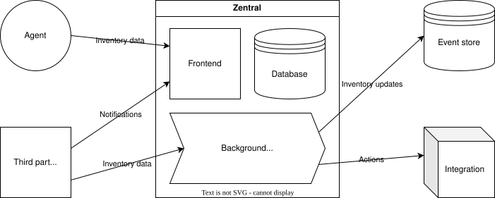

The Zentral Inventory app is used to store all the information about the hardware, software and configuration assets in a unified model. The information comes from the agents managed by Zentral, or from third party inventory sources when an agent managed by Zentral cannot be deployed on the devices. Compliance checks can be configured to run on each device inventory update.

This Zentral module is mandatory in each deployment.

## Available sources

|Name|Type|Platforms|Basic info|Apps|Extra info|
|---|---|---|---|---|---|
|Apple MDM|Agent|Apple|✅|✅|✅|
|Munki|Agent|macOS|✅|✅|✅|
|Osquery|Agent|multiplatform|✅|✅|✅|
|Santa|Agent|macOS|✅| | |
|Jamf|3rd party|Apple|✅|✅|✅|
|Puppet|3rd party|multiplatform|✅|✅|✅|
|Workspace ONE|3rd party|multiplatform|✅|✅|✅|

## Architecture



### Inventory data collection

#### Agents

The managed agents running on each device push inventory data at regular intervals to the Zentral frontend using their custom format and protocol over HTTPS. The inventory data collection for some agents can be dynamically configured by Zentral, with for example the option to collect AWS EC2 instance metadata for Osquery, or Munki custom facts.

#### Third party inventory

The inventory data of third party systems is usually collected using a notify/pull system for efficiency reasons. When an asset is updated in the third party system, a notification (a webhook for example) is sent to Zentral, and an inventory update task is queued. A background worker will pickup the task, and query the inventory for more detailed information about the asset. This allows the notification to be quickly processed. The potentially slower API call to the inventory happens in the background, with a queue to store the tasks in case the inventory is unavailable. This is also efficient, because only the updated data is pulled from the inventory.

If the third party system cannot notify Zentral when assets are updated, a Zentral background worker can also pull the full inventory data at regular intervals.

### Inventory storage

#### Normalisation

The inventory data that is collected is first normalised before being stored. A unified schema is used for all inventory sources, allowing the comparison, aggregation and processing of the inventory data across multiple sources:

 * Business unit
 * Groups

 * System info
 * Hardware info
 * OS version
 * Disks
 * Network Interfaces
 * Principal user
 * Extra facts (custom key/value)
 * Links

 * macOS apps
 * macOS app instances (macOS app + path)
 * Debian packages
 * Windows programs
 * Windows program instances (Windows program + path)
 * Android apps
 * iOS apps

 * Certificates
 * Apple configuration profiles

 * EC2 instance metadata
 * EC2 instance tags
 * Puppet node

#### Storage

Once the data has been normalised, it is stored in the main database (PostgreSQL). For each device and source, complete inventory updates are stored in the form of snapshots, with a special object pointing to the current snapshot for each device and source. 

If the inventory data sent by an agent, once normalised, results in a snapshot that is already present in the database, only the information about the current snapshot for this device and source (last seen) is updated. If the snapshot is different from the last one for the same source and device, it is stored in the database, with a reference to the previous one, and the current snapshot for the device and source is updated to point to the new snapshot.

The assets like OS versions, or macOS apps are deduplicated. If the same application is installed on two different Apple laptops, only one macOS app object is created in the database.

This is similar to the Git object store: device snapshots can be compared to Git trees, assets to Git objects and the current snapshot for a given source to a Git branch.

The retention of the snapshots [can be configured](#snapshot_retention_days). A background task is scheduled to prune the older snapshots while preserving the most recent one for each device and source.

### Inventory events

When an updated inventory snapshot is received for a device and a source, Zentral computes the difference with the previous snapshot, and emits events for each asset update. This is a list of all the Zentral machine update events:

|Asset|Event type|Event tags|
|---|---|---|
|Business Unit|`add_machine_business_unit`|`machine`, `machine_update`, `machine_add_update`|
|Business Unit|`remove_machine_business_unit`|`machine`, `machine_update`, `machine_remove_update`|
|Group|`add_machine_group`|`machine`, `machine_update`, `machine_add_update`|
|Group|`remove_machine_group`|`machine`, `machine_update`, `machine_remove_update`|
|System Info|`add_machine_system_info`|`machine`, `machine_update`, `machine_add_update`|
|System Info|`remove_machine_system_info`|`machine`, `machine_update`, `machine_remove_update`|
|Os Version|`add_machine_os_version`|`machine`, `machine_update`, `machine_add_update`|
|Os Version|`remove_machine_os_version`|`machine`, `machine_update`, `machine_remove_update`|
|Disk|`add_machine_disk`|`machine`, `machine_update`, `machine_add_update`|
|Disk|`remove_machine_disk`|`machine`, `machine_update`, `machine_remove_update`|
|Network Interface|`add_machine_network_interface`|`machine`, `machine_update`, `machine_add_update`|
|Network Interface|`remove_machine_network_interface`|`machine`, `machine_update`, `machine_remove_update`|
|Principal User|`add_machine_principal_user`|`machine`, `machine_update`, `machine_add_update`|
|Principal User|`remove_machine_principal_user`|`machine`, `machine_update`, `machine_remove_update`|
|Extra Facts|`add_machine_extra_facts`|`machine`, `machine_update`, `machine_add_update`|
|Extra Facts|`remove_machine_extra_facts`|`machine`, `machine_update`, `machine_remove_update`|
|Link|`add_machine_link`|`machine`, `machine_update`, `machine_add_update`|
|Link|`remove_machine_link`|`machine`, `machine_update`, `machine_remove_update`|
|Osx App Instance|`add_machine_osx_app_instance`|`machine`, `machine_update`, `machine_add_update`|
|Osx App Instance|`remove_machine_osx_app_instance`|`machine`, `machine_update`, `machine_remove_update`|
|Deb Package|`add_machine_deb_package`|`machine`, `machine_update`, `machine_add_update`|
|Deb Package|`remove_machine_deb_package`|`machine`, `machine_update`, `machine_remove_update`|
|Program Instance|`add_machine_program_instance`|`machine`, `machine_update`, `machine_add_update`|
|Program Instance|`remove_machine_program_instance`|`machine`, `machine_update`, `machine_remove_update`|
|Android App|`add_machine_android_app`|`machine`, `machine_update`, `machine_add_update`|
|Android App|`remove_machine_android_app`|`machine`, `machine_update`, `machine_remove_update`|
|Ios App|`add_machine_ios_app`|`machine`, `machine_update`, `machine_add_update`|
|Ios App|`remove_machine_ios_app`|`machine`, `machine_update`, `machine_remove_update`|
|Certificate|`add_machine_certificate`|`machine`, `machine_update`, `machine_add_update`|
|Certificate|`remove_machine_certificate`|`machine`, `machine_update`, `machine_remove_update`|
|Profile|`add_machine_profile`|`machine`, `machine_update`, `machine_add_update`|
|Profile|`remove_machine_profile`|`machine`, `machine_update`, `machine_remove_update`|
|EC2 Instance Metadata|`add_machine_ec2_instance_metadata`|`machine`, `machine_update`, `machine_add_update`|
|EC2 Instance Metadata|`remove_machine_ec2_instance_metadata`|`machine`, `machine_update`, `machine_remove_update`|
|EC2 Instance Tag|`add_machine_ec2_instance_tag`|`machine`, `machine_update`, `machine_add_update`|
|EC2 Instance Tag|`remove_machine_ec2_instance_tag`|`machine`, `machine_update`, `machine_remove_update`|
|Puppet Node|`add_machine_puppet_node`|`machine`, `machine_update`, `machine_add_update`|
|Puppet Node|`remove_machine_puppet_node`|`machine`, `machine_update`, `machine_remove_update`|

All the above events are standard Zentral events, with the Zentral event metadata containing the machine information, event type, event tags. They are processed by the Zentral event pipeline, and can be filtered and shipped to third party event stores. Event probes can also be configured in Zentral to filter the events and trigger actions.

The inventory snapshot updates, even if they are not different from the stored snapshots, are also run through the compliance checks. For each compliance check in scope for the source / device / platform, the status is computed, and if the status has changed, an `inventory_jmespath_check_status_updated` event is created.

## Compliance checks

### How it works

Compliance checks can be configured to verify the device inventory snapshots. When an inventory update is received (agent) or pulled (3rd party inventory), Zentral fetches the compliance checks in scope for the update, and for each one of them computes its status. If the status has changed, the status for the given device and compliance check is updated in the main database (PostgreSQL) and an `inventory_jmespath_check_status_updated` event is created.

The Zentral inventory compliance checks are scoped using 3 criteria:

 * Inventory source
 * Platforms (Linux, macOS,  Windows, Android, iOS, iPadOS, tvOS)
 * Device tags

The check itself is a [JMESPath](https://jmespath.org/) expression that is evaluated against the full device inventory snapshot tree.

### Example

To test an inventory compliance check:

 * Go to *Inventory > Compliance checks*, and click on the [DevTool] button. This will allow you to evaluate a JMESPath expression against the inventory snapshot tree of a given device and source.

 * Pick a source, and a serial number.

 * In the *JMESPath expression* field, use the following expression to check that the OS version on the device is `13.3.1`:

    ```
    os_version.major == `13` && os_version.minor == `3` && os_version.patch == `1`
    ```

 * Click on the [Test] button. You will see the result of the JMESPath expression, and also a full inventory snapshot tree for the source and device. You can now iterate on the JMESPath expression, and for example update it for the current version of macOS.

 * Once the JMESPath expression is correct, you can click on the [Create] button. This will bring you to a formular where you can pick a name, a description, and a source. You can also scope the compliance check to have it run only on some platforms, or for devices with some given tags.

 * Click on the [Save] button to finish creating the inventory compliance check.

The newly created inventory compliance check will now be evaluated for each scoped inventory update. The last status is available in each device inventory detail page. It will also contribute to the overall compliance status of the devices.

The same configuration can be achieved using a Terraform resource:

```tf
resource "zentral_jmespath_check" "macos-up-to-date" {
  name                = "macOS up to date"
  description         = "Check that the latest macOS version is running."
  source_name         = "munki"
  platforms           = ["MACOS"]
  jmespath_expression = "os_version.major == `13` && os_version.minor == `3` && os_version.patch == `1`"
}
```

## Zentral configuration

A `zentral.contrib.inventory` subsection must be present in the `apps` section in [the configuration](../configuration.md).

### `snapshot_retention_days`

**OPTIONAL**

Number of days (integer) after which the inventory device snapshots are pruned. Defaults to `30`. **IMPORTANT** For each device and source combination, the most recent snapshot is always preserved.

### `metrics`

**OPTIONAL**

This boolean is used to toggle the inventory metrics endpoint for Prometheus. `false` by default.

### `metrics_options`

**OPTIONAL**

A dictionary to configure the available inventory metrics. Only configured metrics will be published. Empty by default.

Six different metric families are available: `android_apps`, `deb_packages`, `ios_apps`, `osx_apps`, `programs`, and `os_versions`. To publish a metric family, the corresponding configuration dictionary must be set in the `metrics_options` section. For each metric family, a mandatory `sources` attribute must be set, to filter the inventory sources. A mandatory `bundle_ids` or `bundle_names` attribute (array of strings) must be set in the `osx_apps` metric family configuration to filter the published bundle metrics. For the `android_apps`, `deb_packages`, `ios_apps`, and `programs` metric families, a `names` attribute (array of strings) must be set, respectively to the list of Android app names, Debian package names, iOS app names, or Windows program names to include in the metrics.

Example:

```json
{
  "metrics": true,
  "metrics_options": {
    "android_apps": {
      "sources": ["Workspace ONE"],
      "names": ["Google Pay"],
    },
    "deb_packages": {
      "sources": ["osquery"],
      "names": ["firefox", "falcon-sensor"]
    },
    "ios_apps": {
      "sources": ["Workspace ONE"],
      "names": ["1Password"],
    },
    "osx_apps": {
      "sources": ["Munki", "osquery"],
      "bundle_ids": ["org.mozilla.firefox", "us.zoom.xos"]
    },
    "programs": {
      "sources": ["osquery"],
      "names": ["Firefox", "Zoom"]
    },
    "os_versions": {
      "sources": ["Munki", "osquery"]
    }
  }
}
```


### `event_serialization`

**OPTIONAL**

This subsection can be used to change the machine information serialization in the Zentral event metadata. There are two options available:

#### `include_groups`

**OPTIONAL**

This boolean is used to toggle the inclusion of the machine groups in the event metadata. `true` by default.

#### `include_principal_user`

**OPTIONAL**

This boolean is used to toggle the inclusion of the principal user in the event metadata. `true` by default.

## Tags and PBAC

### The actions

| Action | Resource | What it gives |
| --- | --- | --- |
| `Inventory::Action::"createTag"` | The taxonomy of the tag (`Inventory::Taxonomy`), or `System::"root"` for a tag without taxonomy | The creation of a tag, and the move of a tag to this taxonomy |
| `Inventory::Action::"viewTag"` | The tag (`Inventory::Tag`), a member of its taxonomy | The tag in the list of the tags, and its detail |
| `Inventory::Action::"updateTag"` | The tag (`Inventory::Tag`), a member of its taxonomy | The update of the tag: its name, its colour, and its move out of its taxonomy |
| `Inventory::Action::"deleteTag"` | The tag (`Inventory::Tag`), a member of its taxonomy | The delete of a tag that nothing uses |
| `Inventory::Action::"tagAnyMachine"` | The tag (`Inventory::Tag`), a member of its taxonomy | The tag on any machine, and its removal: the mass tagging API, and the objects that give tags later |
| `Inventory::Action::"createMachineTag"`, `Inventory::Action::"deleteMachineTag"` | The machine, with the tag in the context | One tag on one machine, on the tags page of the machine |

`createTag`, `updateTag`, `deleteTag` and `tagAnyMachine` are in the `AdminActions` group. `viewTag` is in the `AdminActions`, `UserActions` and `ViewerActions` groups. The `inventory.add_tag`, `inventory.view_tag`, `inventory.change_tag` and `inventory.delete_tag` permissions give nothing. A policy with `resource in Inventory::Taxonomy::"…"` gives `viewTag`, `updateTag`, `deleteTag` and `tagAnyMachine` for the tags of one taxonomy only.

A move of a tag acts on two resources, so it makes two decisions: `updateTag` on the tag, as a member of the taxonomy that it leaves, and `createTag` on the taxonomy that it joins, or on `System::"root"` if the tag leaves its taxonomy. A role that has the two actions for one taxonomy only cannot take a tag from another taxonomy.

A rename is decided twice too: `updateTag` on the tag with its current name, and `updateTag` on the tag with its new name, in the taxonomy where it ends. A policy can match the name of a tag, for `tagAnyMachine` or for another action, so a role must not give a tag a name that its policies do not allow. A refused rename is a 403 in the API: the role can write the tag, so nothing in the answer can be guessed. In the console, it is an error on the name.

A rename of a taxonomy needs `createTag` on the taxonomy with its new name, in addition to the `inventory.change_taxonomy` permission. A policy can match the name of a taxonomy for `createTag`, so a role must not give a taxonomy a name that gives it `createTag` in this taxonomy. A refused rename is a 403 in the API, and an error on the name in the console.

The primary key of a tag can be guessed. So an update or a delete of a tag that the role cannot write gets the answer of an unknown tag: a 404, in the API and in the console.

The list of the tags shows only the tags that the role can see, in the API and on the *Tags* page. It never refuses: a role without a policy gets an empty list. The detail of a tag that the role cannot see is a 404. `updateTag` and `deleteTag` show the tag that they write, but they do not put it in the list: give `viewTag` with them.

`viewTag` does not make the name of a tag a secret. A form of another module that uses tags as a condition shows every tag: the scope of a Santa rule, of a Monolith manifest, of an MDM artifact, of a Turbo job, the filter of a probe. The tags of a machine are shown with `viewMachineTag`.

A tag that is used cannot be deleted: a tag that a machine has, or that an object names, for example an enrollment, a Santa rule, or an MDM artifact. A delete would remove the tag from the machines and from these objects, and a rule that loses an excluded tag would apply to more machines. Remove the tag from the machines and from the objects first: the *Delete tag* page lists them. Zentral does not find an object that names the tag in a JSON value, as a Monolith option or the filter of a probe.

A taxonomy that has tags cannot be deleted. Delete its tags first: each delete needs `deleteTag`.

### The objects that give tags later

Some objects hold tags, and Zentral gives these tags to machines later, when a device or a task uses the object:

| Object | Module | The tags are written |
| --- | --- | --- |
| The tags of an enrollment | Santa, Osquery, Munki, Monolith, Turbo, MDM | when a device enrolls |
| The tag of a query | Osquery | when a result comes in: added if the query has rows, removed if not |
| The tag of a script | Turbo | when a result comes in: added on exit code 0, removed on another exit code |
| A realm group tag mapping | MDM | when a realm user is linked to a device: added and removed |
| A group tag mapping | Google Workspace | by the tag sync: added and removed |
| The tag configuration of an instance | Jamf | when a webhook event comes in: the tags of one taxonomy are set from the names of the Jamf groups, and the missing tags are created |

A save of such an object is a permanent mass tagging. So each create and each update of the object, in the console and with the API, needs `tagAnyMachine` on each tag that the object has after the save. This also applies to an update that does not change the tags: a new SQL statement in a query with a tag changes the machines that get the tag. The import of a standard Osquery pack is the exception: it makes no tag decision. See [Standard pack imports](osquery.md#standard-pack-imports).

- A tag that the role cannot give gets the answer of an unknown tag. The API answers 400, with `Invalid pk "12" - object does not exist.` The console forms do not show the tag.
- An object keeps a tag that the role cannot give only until the role saves the object. In the console, the save removes the tag from the object. The API refuses a `PUT` that keeps the tag.
- A `PUT` must carry the tag attribute of the object: `tags` in the secret of an enrollment and in a group tag mapping, `tag` in a query and in a script. A `PUT` without it gets a 400, with `This field is required.` Use an empty list, or `null` for `tag`, for an object without tags.
- A save that leaves the object without a tag needs no tag decision. A delete needs none.
- A Jamf tag configuration names a taxonomy, not tags. Its save needs `createTag` on the taxonomy, and `tagAnyMachine` on each tag that the taxonomy has. The form shows only the taxonomies that the role can use.
- The objects that exist are not examined at the upgrade. Each one is decided at its next save.

### What Zentral does not decide

Zentral makes the decision when the object is saved, with the role of the user who saves it. It makes no decision when a tag is written on a machine. These operations change the machines that get a tag, and need no tag action:

- The launch of a run of an Osquery query that has a tag.
- The link of a query that has a tag to a pack, and of a pack to a configuration.
- An import of a standard Osquery pack, which can change the SQL of a query with a tag, and link it to the pack. See [Standard pack imports](osquery.md#standard-pack-imports).
- A change of the members of a group that a mapping names.
- An enrollment of a device with a secret that the role can read.
- A new group in Jamf with a name that a tag configuration matches: the tag is created, and given to the machines of the group.
- A version increment of an enrollment.

To keep a role away from a tag completely, also forbid the write actions of the objects that have the tag.

The objects that use tags to select machines, for example a Santa rule, a blueprint or a sub manifest, write no tag. They need no tag action.

## Enrollment secrets and PBAC

An enrollment holds a secret: a device that knows it enrolls. The secret is in the API, in the downloads of the agents, and on some MDM pages. Its read has its own PBAC action, one for each enrollment model, at the user level:

| Action | Module | The secret in |
| --- | --- | --- |
| `Santa::Action::"viewEnrollmentSecret"` | Santa | the API, the plist, the configuration profile |
| `Osquery::Action::"viewEnrollmentSecret"` | Osquery | the API, the macOS package, the Linux script, the PowerShell script |
| `Munki::Action::"viewEnrollmentSecret"` | Munki | the API, the package |
| `Monolith::Action::"viewEnrollmentSecret"` | Monolith | the API, the plist, the configuration profile |
| `Turbo::Action::"viewEnrollmentSecret"` | Turbo | the API, the plist, the configuration profile |
| `MDM::Action::"viewOTAEnrollmentSecret"` | MDM | the API, the profile download of the console |
| `MDM::Action::"viewDEPEnrollmentSecret"` | MDM | the API, the check page, which prints the profile that Apple holds |
| `MDM::Action::"viewUserEnrollmentSecret"` | MDM | the service discovery URL of the user enrollment page |

The resource of each action is the enrollment, for example `Santa::Enrollment`. The enrollment is a member of the meta business unit of its secret, so a policy with `resource in Inventory::MetaBusinessUnit::"…"` gives the secrets of one business unit. The actions are in the `AdminActions` and `UserActions` groups, not in the `ViewerActions` group. No legacy permission maps to them.

The action gives the secret only. The view permission of the enrollment, for example `santa.view_enrollment`, opens the enrollment, and the action decides its secret:

- The list and the detail of the enrollments in the API need the view permission. The secret of each enrollment is decided with the action, in one batch for a list. An enrollment without the action has a `null` secret.
- The response of a create and of an update decides the secret as a read: it has the secret with the action, and a `null` secret without it. The add and change permissions do not read a secret that a policy refuses.
- A download that holds the secret, and the DEP check page, need the view permission and the action: a 403 without one of them. The console shows a download link only with the action. The user enrollment page needs the view permission, and shows its service discovery URL with the action only.

Each response that returns a secret sends one `enrollment_secret_viewed` event: a list, a detail, a create or an update, a download and a page. The event names the enrollments of the response, the meta business unit of each secret, where the secrets were read, and the user or the service account who read them. The event of a create or an update is sent once the write is committed, and the event of a download once the file is built. A Terraform plan reads each enrollment, so it sends one event for each enrollment.

A download or a page refused for the secret is a 403, logged at the `WARNING` level. A `null` secret in an API response is not a refusal: it is not logged.

The service account of the Terraform provider needs these actions: it reads the secrets to build the configurations of the agents.

## HTTP API

### Requests

#### Authentication

API requests are authenticated using a token in the `Authorization` HTTP header:

```
Authorization: Token the_token_string
```

See [API authentication](core.md#api-authentication) for how to create a service account, issue a token for it and set an expiry.

### `/api/inventory/machines/<url_safe_serial_number>/meta/`

* method: GET
* PBAC action: `Inventory::Action::"viewMachineSnapshot"`

Use this endpoint to get general information about a machine.

Example:

```
curl -H "Authorization: Token $ZTL_API_TOKEN" \
     https://$ZTL_FQDN/api/inventory/machines/ABCDEFGHIJKL/meta/
```

Result:

```json
{
    "serial_number": "ABCDEFGHIJKL",
    "urlsafe_serial_number": "ABCDEFGHIJKL",
    "computer_name": "ThisIsATest",
    "platform": "MACOS",
    "type": "LAPTOP",
    "tags": [
        {
            "id": 1,
            "name": "test-device"
        }
    ]
}
```

For convenience, this endpoint accepts serial numbers as URL path parameter. Standard machine serial numbers (like Apple devices serial numbers) do not have to be transformed, but some serial numbers cannot be used safely in a URL. To get the URL safe serial number:

 * compute the URL safe base 64 representation of the serial number without the `=` padding
     * if the result is equal to the serial number itself, you can use it
     * if the result is different, prefix it with a `.` and use it

Because the encoded serial numbers are prefixed with a `.`, serial numbers starting with a `.` also needs to be encoded.

The same mechanism is used to produce user friendly machine URLs in the Zentral UI.

Some examples:

|Serial number|URL safe serial number|Comment|
|---|---|---|
|`ABCDEFGHIJKL`|`ABCDEFGHIJKL`|No need for encoding|
|`.ABCDEFGHIJK`|`.LkFCQ0RFRkdISUpL`|Starts with a dot, requires encoding|
|`l'été au soleil`|`.bCfDqXTDqSBhdSBzb2xlaWw`|Obviously requires encoding|

### `/api/inventory/machines/tags/`

* method: POST
* PBAC action: `Inventory::Action::"tagAnyMachine"`, on each tag that the request adds or removes

Use this endpoint to tag machines using serial numbers or principal user information (unique IDs or principal names). Three different operations are possible: `ADD`, `REMOVE`, `SET`. For the `SET` operation, the `taxonomy` attribute is required. For the `ADD` operation and the `REMOVE` operation, the `taxonomy` attribute must not be used, and the `names` attribute must not be empty. To scope the machines, use either `serial_numbers` or `principal_users`.

The endpoint uses the tags and the taxonomies that exist. It does not create them. Create them first, with `POST /api/inventory/tags/` and `POST /api/inventory/taxonomies/`, in the console, or with Terraform.

The resource of `tagAnyMachine` is the tag (`Inventory::Tag`), not the machine. A tag is a member of its taxonomy, so a policy with `resource in Inventory::Taxonomy::"…"` covers the tags of the taxonomy. The action is in the `AdminActions` group. It adds and it removes.

A policy scoped to machines, for example with `resource in Inventory::MetaBusinessUnit::"…"`, never limits this endpoint. The endpoint can tag any serial number, also a serial number that is not in the inventory. Do not give `tagAnyMachine` to a role that you keep to some machines. Such a role uses the tags page of each machine, with `createMachineTag` and `deleteMachineTag`.

A `SET` operation gives its tags to the machines, and removes the other tags of its taxonomy from them. Its tags must be in its taxonomy. A tag of another taxonomy, or a tag without taxonomy, gets the 400 of an unknown tag. It needs `tagAnyMachine` on each tag of the taxonomy. A `SET` operation without names removes each tag of the taxonomy, and needs the action on each of them too.

An unknown tag and a refused tag get the same 400 (`Unknown tag.`). An unknown taxonomy, a taxonomy with a refused tag and a taxonomy without tags get the same 400 (`Unknown taxonomy.`). Nothing changes then.

The answer gives the number of machines that the request found. With `principal_users`, this number tells how many machines have these principal users, also to a role that can use only one tag. Give `tagAnyMachine` only to a role that can know it.

Example payload to tag machines using their principal users:

```json
{
  "principal_users": {
    "principal_names": ["janeDoe", "johnSmith"],
    "unique_ids": ["max.mustermann@example.com"]
  },
  "operations": [
    {"kind": "SET", "taxonomy": "Department", "names": ["IT"]},
    {"kind": "REMOVE", "names": ["Orange", "Red"]},
    {"kind": "ADD", "names": ["Hamburg", "Blue"]}
  ]
}
```

When this payload is posted, Zentral looks for all the machines having matching principal users. For each machine, three operations are applied:

 1. add the `IT` tag, and remove the other tags of the `Department` taxonomy.
 2. remove the `Orange` and `Red` tags.
 3. add the `Hamburg` and `Blue` tags.

The `Department` taxonomy and the five tags must exist.

Example payload to tag machines using their serial numbers:

```json
{
  "serial_numbers": ["123456789", "987654321"],
  "operations": [
    {"kind": "SET", "taxonomy": "Department", "names": ["HR"]}
  ]
}
```

When this payload is posted, Zentral looks for all the machines having matching serial numbers. For each machine, one operations is applied:

 1. add the `HR` tag, and remove the other tags of the `Department` taxonomy.

The response format is:

```json
{
  "machines": {"found": 2},
  "tags": {"added": 2,
           "removed": 1}
}
```

### `/api/inventory/tags/`

* method: GET, POST
* PBAC actions:
    * GET: `Inventory::Action::"viewTag"`, on each tag. The list has only the tags that the caller can see.
    * POST: `Inventory::Action::"createTag"`, on the taxonomy of the new tag, or on `System::"root"` for a tag without taxonomy

A `POST` gets a 403 when no policy gives `createTag` to the caller, and when the tag has no taxonomy and the caller cannot create one on `System::"root"`. A taxonomy where the caller cannot create a tag gets the 400 of an unknown taxonomy.

### `/api/inventory/tags/<id>/`

* method: GET, PUT, DELETE
* PBAC actions:
    * GET: `Inventory::Action::"viewTag"`, on the tag
    * PUT: `Inventory::Action::"updateTag"`, on the tag. A `PUT` that changes the taxonomy also needs `Inventory::Action::"createTag"` on the new taxonomy, or on `System::"root"` if the tag leaves its taxonomy. A `PUT` that changes the name also needs `Inventory::Action::"updateTag"` on the tag with its new name: a 403 without it.
    * DELETE: `Inventory::Action::"deleteTag"`, on the tag

A `GET` on a tag that the caller cannot see, and a `PUT` or a `DELETE` on a tag that the caller cannot write, get a 404, as for an unknown tag. A `DELETE` on a tag that is used gets a 400.

### `/api/inventory/cleanup/`

* method: POST
* PBAC actions:
	* `Inventory::Action::"deleteMachineSnapshot"`
* optional parameter:
	* `days`: The number of days (`1` → `3660`) of history to keep. Defaults to `30` or the value of `snapshot_retention_days` in the inventory app config.

Use this endpoint to trigger an inventory history cleanup.

Example:

```bash
curl -XPOST \
  -H "Authorization: Token $ZTL_API_TOKEN" \
  https://$ZTL_FQDN/api/inventory/cleanup/\
  |python3 -m json.tool
```

Response:

```json
{
  "task_id": "b1512b8d-1e17-4181-a1c3-93a7243fddd4",
  "task_result_url": "/api/task_result/b1512b8d-1e17-4181-a1c3-93a7243fddd4/"
}
```

### `/api/inventory/machines/archive/`

* method: POST
* Content-Type: application/json
* PBAC action:
    * `Inventory::Action::"updateMachineSnapshot"`

Use this endpoint to archive machines using their serial numbers. The inventory data will be kept in the database, in case the machines show up again, but the machines will not be displayed when browsing or exporting the inventory. Up to 1000 machines can be archived per API call.

Example:

```bash
curl -XPOST \
  -H "Authorization: Token $ZTL_API_TOKEN" \
  -H 'Content-Type: application/json' \
  -d '{"serial_numbers": ["0123456789"]}' \
  https://$ZTL_FQDN/api/inventory/machines/archive/\
  |python3 -m json.tool
```

Response:

```json
{"current_machine_snapshots": 0}
```

### `/api/inventory/machines/prune/`

* method: POST
* Content-Type: application/json
* PBAC action:
    * `Inventory::Action::"deleteMachineSnapshot"`

Use this endpoint to prune machines using their serial numbers. The inventory data will be removed from the database. Up to 1000 machines can be pruned per API call.

Example:

```bash
curl -XPOST \
  -H "Authorization: Token $ZTL_API_TOKEN" \
  -H 'Content-Type: application/json' \
  -d '{"serial_numbers": ["0123456789"]}' \
  https://$ZTL_FQDN/api/inventory/machines/prune/\
  |python3 -m json.tool
```

Response:

```json
{"current_machine_snapshots": 1,
 "machine_snapshots": 2,
 "machine_snapshot_commits": 13}
```

### `/api/inventory/android_apps/export/`

* method: POST
* Content-Type: application/json
* PBAC action:
    * `Inventory::Action::"viewAndroidApp"`
* optional parameters:
    * `export_format`: `csv` or `xlsx`. Defaults to `xlsx`.
    * `source`: The ID of an inventory source. Only Android apps collected via this source will be included in the export.
    * `last_seen`: `1d`, `7d`, `14d`, `30d`, `45d`, `90d`. Only Android apps collected within this time window will be included in the export.
    * `display_name`: A search string.

Use this endpoint to trigger an Android apps export task. The result of this task will be a spreadsheet.

Example:

```bash
curl -XPOST \
  -H "Authorization: Token $ZTL_API_TOKEN" \
  -H 'Content-Type: application/json' \
  -d '{"display_name": "Chrome"}' \
  https://$ZTL_FQDN/api/inventory/android_apps/export/\
  |python3 -m json.tool
```

Response:

```json
{
  "task_id": "b1512b8d-1e17-4181-a1c3-93a7243fddd3",
  "task_result_url": "/api/task_result/b1512b8d-1e17-4181-a1c3-93a7243fddd3/"
}
```

### `/api/inventory/deb_packages/export/`

* method: POST
* Content-Type: application/json
* PBAC action:
    * `Inventory::Action::"viewDebPackage"`
* optional parameters:
    * `export_format`: `csv` or `xlsx`. Defaults to `xlsx`.
    * `source`: The ID of an inventory source. Only Debian packages collected via this source will be included in the export.
    * `last_seen`: `1d`, `7d`, `14d`, `30d`, `45d`, `90d`. Only Debian packages collected within this time window will be included in the export.
    * `name`: A search string.

Use this endpoint to trigger a Debian packages export task. The result of this task will be a spreadsheet.

Example:

```bash
curl -XPOST \
  -H "Authorization: Token $ZTL_API_TOKEN" \
  -H 'Content-Type: application/json' \
  -d '{"name": "Firefox", "last_seen": "90d"}' \
  https://$ZTL_FQDN/api/inventory/deb_packages/export/\
  |python3 -m json.tool
```

Response:

```json
{
  "task_id": "b1512b8d-1e17-4181-a1c3-93a9243fddd3",
  "task_result_url": "/api/task_result/b1512b8d-1e17-4181-a1c3-93a9243fddd3/"
}
```

### `/api/inventory/ios_apps/export/`

* method: POST
* Content-Type: application/json
* PBAC action:
    * `Inventory::Action::"viewIOSApp"`
* optional parameters:
    * `export_format`: `csv` or `xlsx`. Defaults to `xlsx`.
    * `source`: The ID of an inventory source. Only iOS apps collected via this source will be included in the export.
    * `last_seen`: `1d`, `7d`, `14d`, `30d`, `45d`, `90d`. Only iOS apps collected within this time window will be included in the export.
    * `name`: A search string.

Use this endpoint to trigger an iOS apps export task. The result of this task will be a spreadsheet.

Example:

```bash
curl -XPOST \
  -H "Authorization: Token $ZTL_API_TOKEN" \
  -H 'Content-Type: application/json' \
  -d '{"name": "1Password", "last_seen": "1d"}' \
  https://$ZTL_FQDN/api/inventory/ios_apps/export/\
  |python3 -m json.tool
```

Response:

```json
{
  "task_id": "b1512b8d-1e17-4181-a1c3-83a9243fddd3",
  "task_result_url": "/api/task_result/b1512b8d-1e17-4181-a1c3-83a9243fddd3/"
}
```

### `/api/inventory/macos_apps/export/`

* method: POST
* Content-Type: application/json
* PBAC action:
    * `Inventory::Action::"viewOSXApp"`
    * `Inventory::Action::"viewOSXAppInstance"`
* optional parameters:
    * `export_format`: `csv` or `xlsx`. Defaults to `xlsx`.
    * `source`: The ID of an inventory source. Only macOS apps collected via this source will be included in the export.
    * `last_seen`: `1d`, `7d`, `14d`, `30d`, `45d`, `90d`. Only macOS apps collected within this time window will be included in the export.
    * `bundle_name`: A search string.

Use this endpoint to trigger a macOS apps export task. The result of this task will be a spreadsheet.

Example:

```bash
curl -XPOST \
  -H "Authorization: Token $ZTL_API_TOKEN" \
  -H 'Content-Type: application/json' \
  -d '{"bundle_name": "1Password", "last_seen": "14d", "source": 4641}' \
  https://$ZTL_FQDN/api/inventory/macos_apps/export/\
  |python3 -m json.tool
```

Response:

```json
{
  "task_id": "c1512b8d-1e17-4181-a1c3-83a9243fddd3",
  "task_result_url": "/api/task_result/c1512b8d-1e17-4181-a1c3-83a9243fddd3/"
}
```

### `/api/inventory/programs/export/`

* method: POST
* Content-Type: application/json
* PBAC action:
    * `Inventory::Action::"viewProgram"`
    * `Inventory::Action::"viewProgramInstance"`
* optional parameters:
    * `export_format`: `csv` or `xlsx`. Defaults to `xlsx`.
    * `source`: The ID of an inventory source. Only Windows programs collected via this source will be included in the export.
    * `last_seen`: `1d`, `7d`, `14d`, `30d`, `45d`, `90d`. Only Windows programs collected within this time window will be included in the export.
    * `name`: A search string.

Use this endpoint to trigger a Windows programs export task. The result of this task will be a spreadsheet.

Example:

```bash
curl -XPOST \
  -H "Authorization: Token $ZTL_API_TOKEN" \
  -H 'Content-Type: application/json' \
  -d '{"name": "1Password", "export_format": "csv"}' \
  https://$ZTL_FQDN/api/inventory/programs/export/\
  |python3 -m json.tool
```

Response:

```json
{
  "task_id": "c2512b8d-1e17-4181-a1c3-83a9243fddd3",
  "task_result_url": "/api/task_result/c2512b8d-1e17-4181-a1c3-83a9243fddd3/"
}
```

### `/api/inventory/machines/export_android_apps/`

* method: POST
* PBAC action:
	* `Inventory::Action::"viewAndroidApp"`
* optional parameter:
	* `source_name`: The name of an inventory source. Only machines with Android apps collected via this source will be included in the export.

Use this endpoint to trigger a machine Android apps export task. The result of this task will be a Zip archive containing a CSV file for each source.

Example of an export limited to the `Workspace ONE` source:

```bash
curl -XPOST \
  -H "Authorization: Token $ZTL_API_TOKEN" \
  "https://$ZTL_FQDN/api/inventory/machines/export_android_apps/?source_name=Workspace%20ONE" \
  |python3 -m json.tool
```

Response:

```json
{
  "task_id": "b1512b8d-1e17-4181-a1c3-93a7243fddd3",
  "task_result_url": "/api/task_result/b1512b8d-1e17-4181-a1c3-93a7243fddd3/"
}
```
### `/api/inventory/machines/export_deb_packages/`

* method: POST
* PBAC action:
	* `Inventory::Action::"viewDebPackage"`
* optional parameter:
	* `source_name`: The name of an inventory source. Only machines with Debian packages collected via this source will be included in the export.

Use this endpoint to trigger a machine Debian packages export task. The result of this task will be a Zip archive containing a CSV file for each source.

Example:

```bash
curl -XPOST \
  -H "Authorization: Token $ZTL_API_TOKEN" \
  https://$ZTL_FQDN/api/inventory/machines/export_deb_packages/\
  |python3 -m json.tool
```

Response:

```json
{
  "task_id": "b1512b8d-1e17-4181-a1c3-93a7243fddd3",
  "task_result_url": "/api/task_result/b1512b8d-1e17-4181-a1c3-93a7243fddd3/"
}
```

### `/api/inventory/machines/export_ios_apps/`

* method: POST
* PBAC action:
	* `Inventory::Action::"viewIOSApp"`
* optional parameter:
	* `source_name`: The name of an inventory source. Only machines with iOS apps collected via this source will be included in the export.

Use this endpoint to trigger a machine iOS apps export task. The result of this task will be a Zip archive containing a CSV file for each source.

Example:

```bash
curl -XPOST \
  -H "Authorization: Token $ZTL_API_TOKEN" \
  https://$ZTL_FQDN/api/inventory/machines/export_ios_apps/\
  |python3 -m json.tool
```

Response:

```json
{
  "task_id": "b1512b8d-1e17-4181-a1c3-93a7243fddd3",
  "task_result_url": "/api/task_result/b1512b8d-1e17-4181-a1c3-93a7243fddd3/"
}
```

### `/api/inventory/machines/export_macos_app_instances/`

* method: POST
* PBAC actions:
	* `Inventory::Action::"viewOSXApp"`
	* `Inventory::Action::"viewOSXAppInstance"`
* optional parameter:
	* `source_name`: The name of an inventory source. Only machines with macOS apps collected via this source will be included in the export.

Use this endpoint to trigger a machine macOS app instances export task. The result of this task will be a Zip archive containing a CSV file for each source.

Example:

```bash
curl -XPOST \
  -H "Authorization: Token $ZTL_API_TOKEN" \
  https://$ZTL_FQDN/api/inventory/machines/export_macos_app_instances/\
  |python3 -m json.tool
```

Response:

```json
{
  "task_id": "b1512b8d-1e17-4181-a1c3-93a7243fddd3",
  "task_result_url": "/api/task_result/b1512b8d-1e17-4181-a1c3-93a7243fddd3/"
}
```

### `/api/inventory/machines/export_program_instances/`

* method: POST
* PBAC actions:
	* `Inventory::Action::"viewProgram"`
	* `Inventory::Action::"viewProgramInstance"`
* optional parameter:
	* `source_name`: The name of an inventory source. Only machines with Windows programs collected via this source will be included in the export.

Use this endpoint to trigger a machine Windows program instances export task. The result of this task will be a Zip archive containing a CSV file for each source.

Example:

```bash
curl -XPOST \
  -H "Authorization: Token $ZTL_API_TOKEN" \
  https://$ZTL_FQDN/api/inventory/machines/export_program_instances/\
  |python3 -m json.tool
```

Response:

```json
{
  "task_id": "b1512b8d-1e17-4181-a1c3-93a7243fddd3",
  "task_result_url": "/api/task_result/b1512b8d-1e17-4181-a1c3-93a7243fddd3/"
}
```

### `/api/inventory/machines/export_snapshots/`

* method: POST
* PBAC actions:
	* `Inventory::Action::"viewMachineSnapshot"`
* optional parameter:
	* `source_name`: The name of an inventory source. Only machine snapshots collected via this source will be included in the export.

Use this endpoint to trigger a machine snapshots export task. The result of this task will be a Zip archive containing a JSONL file for each source.

Example:

```bash
curl -XPOST \
  -H "Authorization: Token $ZTL_API_TOKEN" \
  https://$ZTL_FQDN/api/inventory/machines/export_snapshots/\
  |python3 -m json.tool
```

Response:

```json
{
  "task_id": "b1512b8d-1e17-4181-a1c3-93a7243fddd3",
  "task_result_url": "/api/task_result/b1512b8d-1e17-4181-a1c3-93a7243fddd3/"
}
```

### `/api/inventory/full_export/`

* method: POST
* PBAC actions:
	* `Inventory::Action::"viewMachineSnapshot"`

Use this endpoint to start a full inventory export. The export is a ZIP archive of `.jsonl` files by default, with one set of files per table, and a `manifest.json` file. It contains the current snapshot of each machine and source, and the objects that these snapshots reference: operating system versions, applications, certificates, profiles, disks, … A snapshot that a newer snapshot replaced, and an object that only such a snapshot references, are not exported. All the tables are read in one transaction, so they are consistent with each other.

The optional `tables` attribute limits the export to a list of tables. An unknown table, or an empty list, gives a `400` response that lists the valid tables.

The optional `export_format` attribute selects the format: `JSONL`, the default, `PARQUET`, or `CSV`. See [the Parquet export](#the-parquet-export) and [the CSV export](#the-csv-export) below.

| Tables | Content |
|---|---|
| `machine` | The current snapshot of each machine and source. `ms_id` is the identifier of the snapshot. |
| `business_unit`, `meta_business_unit` | The business units of the snapshots, and their meta business units. |
| `source` | The inventory sources of the snapshots and of the business units. |
| `os_version`, `system_info`, `principal_user` | The operating system versions, the system information and the principal users of the snapshots. |
| `disk`, `machine_disk` | The disks, and their link to the snapshots. |
| `network_interface`, `machine_network_interface` | The network interfaces, and their link to the snapshots. |
| `certificate`, `machine_certificate` | The certificates of the snapshots, the signers of the applications and of the profiles, with their chains, and the link of the certificates to the snapshots. |
| `profile`, `machine_profile` | The configuration profiles, and their link to the snapshots. |
| `macos_app`, `macos_app_instance`, `machine_macos_app_instance` | The macOS applications, their instances, and the link of the instances to the snapshots. |
| `android_app`, `machine_android_app` | The Android applications, and their link to the snapshots. |
| `deb_package`, `machine_deb_package` | The Debian packages, and their link to the snapshots. |
| `ec2_instance_metadata`, `ec2_instance_tag`, `machine_ec2_instance_tag` | The EC2 instance metadata of the snapshots, the EC2 instance tags, and their link to the snapshots. |
| `ios_app`, `machine_ios_app` | The iOS applications, and their link to the snapshots. |
| `program`, `program_instance`, `machine_program_instance` | The Windows programs, their instances, and the link of the instances to the snapshots. |

A `machine_*` table links the snapshots to the rows of another table: `ms_id` is the identifier of the snapshot, and the other column is the identifier of the row. The files of a table are named `zentral_<table>_<index>.jsonl`. The index starts at `0001`, and a table with many rows has more than one file. A table without a row has no file.

The task result carries a manifest, also present in the archive as `manifest.json`. The manifest gives the tables, with their row counts, their columns and their files, and the files, with their table, row count, size and SHA-256 digest. The keys of `files` are the names of the `.jsonl` files in the archive.

Zentral does not delete the exports. The retention of the files under `exports/` in the storage is a responsibility of the deployment, for example with a lifecycle policy on the bucket.

#### The Parquet export

With `"export_format": "PARQUET"`, each table is a set of [Apache Parquet](https://parquet.apache.org/) files in a directory of the storage, and not a ZIP archive. The manifest gives the `location` of the directory, for example `exports/inventory/20260911T100000Z-3f9c1a2b/`, and the files, keyed by their path in the directory: `machine/machine-00001.parquet`, `machine/machine-00002.parquet`, … A table with many rows has more than one file. A table without a row has one file without rows, so that the columns of the table are still available. The directory also contains the manifest, as `manifest.json`.

The columns of a table have a type, given in the manifest:

| PostgreSQL type | Parquet type |
|---|---|
| `text`, `varchar` | `string` |
| `integer` | `int32` |
| `bigint` | `int64` |
| `boolean` | `bool` |
| `timestamp` | `timestamp[us, tz=UTC]` |
| `json`, `jsonb` | `string`, with the JSON text |
| `inet` | `string` |

Download the files with the task result endpoint: [`/api/task_result/<uuid:task_id>/download/`](core.md#apitask_resultuuidtask_iddownload) gives the manifest with a download URL for each file, and `?file=<key>` downloads one file. With an S3 or a GCS bucket, the manifest also gives the URL of each file in the storage, and a tool reads the files without a download:

```sql
-- DuckDB, with the URLs of the manifest
SELECT platform, count(*) FROM read_parquet(['https://…/machine/machine-00001.parquet']) GROUP BY 1;
-- DuckDB, with the downloaded files
SELECT * FROM read_parquet('machine/*.parquet');
```

A tool with access to the bucket reads a table from its directory. With Athena:

```sql
CREATE EXTERNAL TABLE machine (serial_number string, last_seen timestamp, ms_id int, platform string)
STORED AS PARQUET
LOCATION 's3://acme-zentral/exports/inventory/20260911T100000Z-3f9c1a2b/machine/';
```

With Snowflake:

```sql
SELECT $1:serial_number, $1:platform
FROM @acme_zentral/exports/inventory/20260911T100000Z-3f9c1a2b/machine/ (FILE_FORMAT => 'parquet');
```

Example:

```bash
curl -XPOST \
  -H "Authorization: Token $ZTL_API_TOKEN" \
  -H "Content-Type: application/json" \
  -d '{"export_format": "PARQUET", "tables": ["machine", "os_version"]}' \
  https://$ZTL_FQDN/api/inventory/full_export/\
  |python3 -m json.tool
```

Response:

```json
{
  "task_id": "5ecb057b-57cc-41e4-a07e-fcc357d7a5c7",
  "task_result_url": "/api/task_result/5ecb057b-57cc-41e4-a07e-fcc357d7a5c7/"
}
```

Task result, when the task is done (see [`/api/task_result/<uuid:task_id>/`](core.md#apitask_resultuuidtask_id)):

```json
{
  "name": "zentral.contrib.inventory.tasks.export_full_inventory",
  "id": "5ecb057b-57cc-41e4-a07e-fcc357d7a5c7",
  "status": "SUCCESS",
  "unready": false,
  "download_url": "/api/task_result/5ecb057b-57cc-41e4-a07e-fcc357d7a5c7/download/",
  "result": {
    "manifest": {
      "version": 1,
      "export_id": "20260911T100000Z-3f9c1a2b",
      "exported_at": "2026-09-11T10:00:00Z",
      "format": "PARQUET",
      "tables": {
        "machine": {
          "rows": 4213,
          "columns": [{"name": "serial_number", "type": "string", "nullable": true}, "…"],
          "files": ["machine/machine-00001.parquet"]
        },
        "os_version": {
          "rows": 17,
          "columns": [{"name": "id", "type": "int32", "nullable": true}, "…"],
          "files": ["os_version/os_version-00001.parquet"]
        }
      },
      "files": {
        "machine/machine-00001.parquet": {"table": "machine", "rows": 4213, "size": 1284906, "sha256": "…"},
        "os_version/os_version-00001.parquet": {"table": "os_version", "rows": 17, "size": 3021, "sha256": "…"}
      }
    }
  }
}
```

With the `JSONL` format, the result also carries the headers of the ZIP archive, the keys of `files` are the names of the `.jsonl` files in the archive, and the columns have no type.

#### The CSV export

With `"export_format": "CSV"`, each table is a set of `.csv` files in a directory of the storage, like the Parquet export. The manifest gives the `location` of the directory, and the files keyed by their path in the directory: `machine/machine-00001.csv`, `machine/machine-00002.csv`, … The directory also contains the manifest, as `manifest.json`.

Each file starts with the header row. You can open one file of a table on its own, and a reader that skips the header of each file reads all the files of a table together. The `rows` of a file in the manifest counts the data rows; the `size` and the `sha256` cover the whole file, with its header. A table without a row has one file with the header and no data row. The columns of a table have no type in the manifest: they are the names of the header row, in the same order.

The files follow RFC 4180: a comma separates the values, a `"` quotes a value that needs it, a quote in a value is doubled, and a line break ends each row. The files are UTF-8, without a byte order mark. The values:

| PostgreSQL type | CSV value |
|---|---|
| `text`, `varchar`, `inet` | the value |
| `integer`, `bigint` | the number |
| `boolean` | `true` or `false` |
| `timestamp` | ISO 8601 in UTC, for example `2026-09-11T10:00:00.123456Z` |
| `json`, `jsonb` | the JSON text |

An empty field is a `NULL` **or** an empty string. A CSV does not make the difference; use the Parquet export if you need it.

A value can contain a line break, for example the name of a computer. The file quotes such a value, as RFC 4180 asks. DuckDB and the `csv` module of Python read it; a reader that splits the file on the line breaks, for example the Hive SerDes of Athena, does not.

Download the files with the task result endpoint, like the Parquet files: [`/api/task_result/<uuid:task_id>/download/`](core.md#apitask_resultuuidtask_iddownload) gives the manifest with a download URL for each file, and `?file=<key>` downloads one file. With an S3 or a GCS bucket, the manifest also gives the URL of each file in the storage.

```sql
-- DuckDB, with the URLs of the manifest
SELECT platform, count(*) FROM read_csv(['https://…/machine/machine-00001.csv']) GROUP BY 1;
-- DuckDB, with the downloaded files
SELECT * FROM read_csv('machine/*.csv');
```
